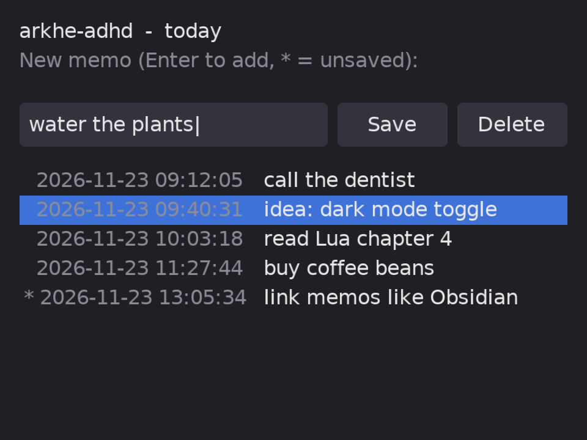

# arkhe-adhd

A personal quick-notes (memos) app built with ADHD in mind: write things down fast, with no friction, and later be able to link ideas together, like in Obsidian.



The app works by **session**. Each session is a `.md` file stored in the `arkhe_sessions` folder (created on startup by both the GUI and the terminal version), with a title, a context and the memos with their date and time:

```
#study
#   lua notes
2026-10-27 20:04:25 - a memo
2026-10-27 20:04:26 - another memo
```

## How to run

### Graphical interface (LÖVE)

Requires [LÖVE](https://love2d.org) 11.5. From the project folder:

```bash
love .
```

On macOS, if the `love` command is not on your PATH:

```bash
/Applications/love.app/Contents/MacOS/love .
```

- On the start screen, type a session name or click **Open session** to pick an existing one
- **Enter** adds a memo
- **↑ / ↓** or a click selects a memo
- **Delete** (key or button) removes the selected memo, from the file too
- **Ctrl+S / Cmd+S** or the **Save** button writes new memos to the file (it also saves on close)

### macOS app

To build an `arkhe-adhd.app` that opens with a double click (requires LÖVE in `/Applications`):

```bash
./build_mac.sh
```

The app is created in `build/arkhe-adhd.app`. Before building, set `pasta_projeto` at the top of `gui.lua` to the project folder path on your machine: that is where the built app stores sessions. If the project is on the Desktop or in Documents, macOS asks for access permission the first time.

### Terminal

Requires Lua 5.3 and [LuaFileSystem](https://lunarmodules.github.io/luafilesystem/) (to create and enter the `arkhe_sessions` folder):

```bash
luarocks install luafilesystem
lua arkhe.lua
```

## Structure

| File | What it does |
| --- | --- |
| `functions.lua` | memo and session logic (shared by both versions) |
| `arkhe.lua` | terminal version |
| `main.lua` | LÖVE entry point (only loads `gui.lua`) |
| `gui.lua` | graphical interface |
| `conf.lua` | LÖVE window settings |
| `build_mac.sh` | builds the macOS app into `build/` |

LÖVE runs on LuaJIT (Lua 5.1 compatible), while the terminal version runs on Lua 5.3. That is why `functions.lua` must only use what exists in both: no `//`, no bitwise operators (`&`, `|`, `~`) and no `utf8` inside it.

## License

[MIT](LICENSE)
